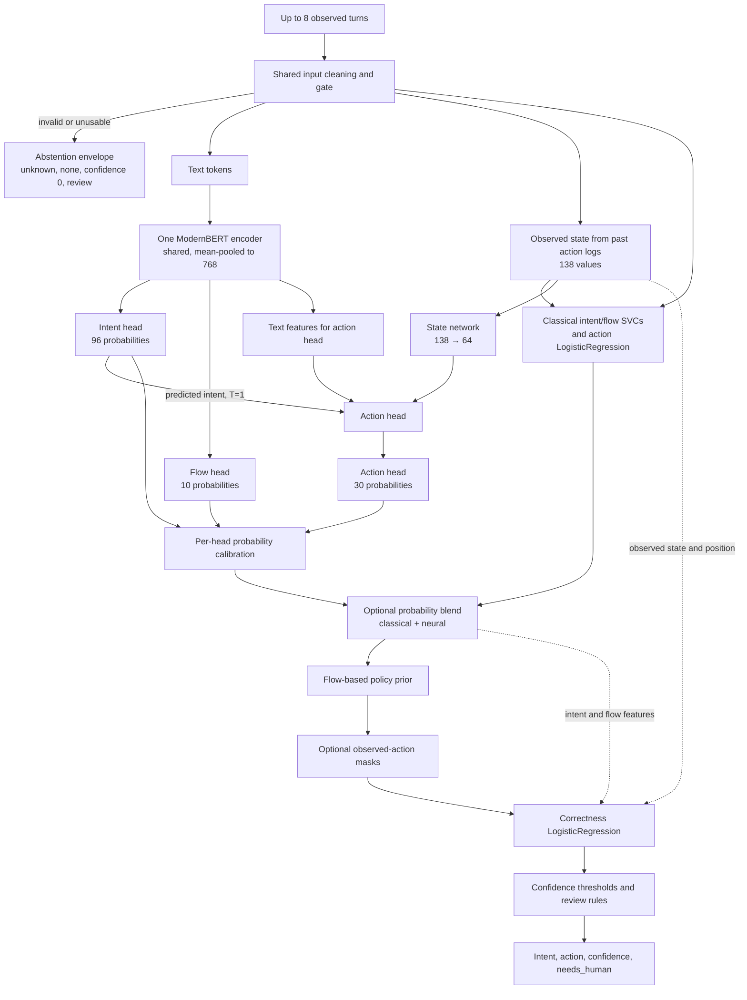

# How to explain the model choices

This guide is for presenting the design and the reasoning behind it. It describes the system under evaluation; it does not say which candidate wins or recommend a production switch.

## Start with the prediction task

Each request contains up to eight observed dialogue turns. A turn can be from the customer, the support agent, or the action/tool log. An action-log turn records an earlier tool event, such as an order lookup or “identity verification in progress.” It is historical input, not the next action label. The event alone does not prove that a business check completed successfully.
The window can be the tail of a longer dialogue. We predict the next action after that prefix, not necessarily a literal ninth chat turn.
“Recorded action” has two uses in discussions of this dataset: past log events are input, while the recorded next action is the training target. The action/policy conflict concerns that target, which can disagree with the written procedure. It is never included as an input feature.

The service predicts the current case's intent from 96 labels and a next action from 30 labels. Internally it also predicts a flow from 10 labels. It estimates whether the chosen action is likely to be correct, then applies review rules. It does not generate the agent's next customer-facing sentence.
The HTTP response echoes the request ID and returns intent, action, confidence and human-review status; flow remains internal.

## Why there seem to be so many models

The published baseline is a separate, simpler system: a bag-of-words intent centroid over the last four turns, followed by a majority-action lookup for the predicted intent and dialogue-position bucket. Our improved classical reference has four learned pieces:

1. An intent LinearSVC over 96 intent labels.
2. A flow LinearSVC over 10 flows.
3. An action LogisticRegression over 30 actions.
4. A correctness LogisticRegression that estimates whether the selected action is right.

These are four fitted predictors in the reference pipeline. The action and correctness models solve different tasks: the action model chooses a label; the correctness model estimates risk for that choice.

The new ModernBERT candidate uses one 149-million-parameter encoder shared by three output heads. A shared encoder reads the text once and produces one pooled representation, so intent, flow, and action do not each need a separate transformer. The pooled representation is 768 values wide. The intent head has 96 outputs, the flow head has 10, and the action head has 30.

For an ensemble candidate, we combine the predictions from the three classical label predictors with the three heads of the one joint neural encoder. A separate correctness LogisticRegression is then fitted for the combined candidate. Counting learned components this way gives five: three classical label predictors, one joint neural model, and one correctness predictor. The neural-only candidate has two: the one joint neural model and its correctness predictor. Its three heads do not make it three encoders.

The neural action head receives three inputs: the pooled text representation, the predicted-intent probabilities, and a compact representation of observed action state. That state has 138 values and passes through a small network to 64 values before joining the action features. The intent probabilities supplied to the action head use temperature 1, as during training. Calibration temperatures are applied to exported head probabilities; they do not rewrite the action head's internal input.

## Model and decision flow

In the neural-only candidate, the classical probability blend is omitted. In the ensemble candidate, the blend combines classical and neural probabilities for intent, flow, and action, using weights selected on the selection partition. It is a blend of predictions from two model families. CPU and CUDA describe where code executes; they are not model types and are not the two sides of this probability blend.

The policy prior uses predicted flow probabilities to increase the scores of actions that are permitted for likely flows. The mask stage supports removing actions whose configured prerequisites have not yet appeared in the action log; the current policy has no active prerequisite rules. It does not automatically ban every repeated action. Other policy rules can require review. These are deterministic decision steps around the predictors, not additional learned models. The correctness LogisticRegression and review thresholds are also distinct: one estimates action correctness; the thresholds turn that estimate into a human-review decision.

Temperature calibration fits scalar values that adjust probability sharpness. It does not create another large model. The gate validates and cleans the request; the policy prior, masks, and rules constrain decisions. The retriever is a search index that supplies examples to an optional hosted prompt; it is not an LLM or a neural encoder.
The native policy file is `policy/policy.toml`. Its permitted-action lists were copied from the flow-level lists published in the training rows and checked for consistency; they are not learned from which gold actions happen most often. The original `guidelines.json` provides the written procedures used in the hosted prompt. The TOML also holds aliases, risk tiers and review rules. The current service can reload this file; the controlled neural experiment uses a frozen snapshot.

## Why include observed state?

The text says what the customer and agent said. Action-log turns record earlier tool events. The fixed 138-value state summarizes those observed events and dialogue shape, so the action head can distinguish, for example, a request before a verification event appears in the log from one after it appears, without guessing solely from prose.

The state contains only actions present in the request history. Gold intent and the target next action are labels for training and evaluation, never input features. The intent signal sent to the action head is the model's own predicted distribution, not the true intent. This prevents training from using an answer field that would be unavailable at serving time.

## Why share an encoder and use three heads?

Intent, flow, and action are related tasks over the same dialogue. One encoder can reuse its text representation while small output heads learn each label space. The flow distribution also informs the policy prior. A separate flow head keeps the 10-flow prediction explicit even though the system also reports a more specific intent.

The action head gets the predicted intent distribution because the same action can make sense for different reasons depending on what the customer wants. It gets observed state because the next useful action depends on what the agent has already done. Both are available at inference. The head uses the internal intent distribution at temperature 1 so its inference path matches the feature it learned during training; export-time temperature calibration is a later probability-reporting step.

## Why split fit, selection, calibration, and confirmation?

The rows are separated by conversation so turns from one conversation cannot leak into another partition:

- **Fit, about 65%:** train neural weights and fit the matching classical reference.
- **Selection, about 10%:** choose checkpoints and classical/neural blend weights.
- **Calibration, about 10%:** fit per-head temperatures, correctness predictors, and review thresholds.
- **Confirmation, about 15%:** evaluate the frozen choices once.

Selection is part of development: we use it to decide which checkpoint and blend to carry forward. Calibration is for probability and review behavior, not for choosing among many candidates. Confirmation is held back until those choices are fixed. This is a new split of public training data that had been studied before; describe it as a current-round holdout, not a pristine hidden test. Calibration scores also have limitations because some upstream temperature choices use calibration labels.

## Keep the model experiments separate

The optional neural HTTP service runs the frozen classical/neural candidate through the shared Triage stages with its calibrated thresholds. For the controlled comparison, its LLM action step and second-intent routing are off. It is not the current production default.

The Luna, Haiku, and Gemini hosted comparison is a separate action-only experiment. Those hosted models receive a prompt and retrieved examples and propose an action; their run is evaluated against a frozen CPU fallback. That branch is not combined with the neural encoder, so it does not establish that “ModernBERT plus an LLM” works better.

## CPU, CUDA, and the word “blend”

The original three-epoch quality experiment used CPU execution. A later [GPU extension](GPU_RESULTS.md)
loaded the same checkpoint onto the shared A6000, matched the frozen CPU decisions on 100 selection
rows, and exercised 100 actual HTTP requests. Eight fitting-only full-model optimizer updates also
worked on CUDA after fused AdamW reduced temporary memory. That was a training mechanics check;
it did not save a new candidate or replace the completed quality comparison. CPU and CUDA are now
measured execution options for this experimental backend. The model's failed operating guard still
applies regardless of which device runs it.

When presenting the candidate ensemble, say “classical/neural probability blend.” Do not say “CPU/CUDA blend”: that would confuse the model sources with the hardware used to execute them.

## A concise presentation sequence

1. Explain the two task labels, intent and action, the internal flow prediction, and the separate confidence and review outputs. Then introduce the four classical predictors.
2. Introduce ModernBERT as one shared encoder with three small heads, then show why predicted intent and observed action state feed the action head.
3. Separate model predictions from the policy prior, masks, correctness estimate, and review rules.
4. Explain the conversation-level split and why selection, calibration, and confirmation have different jobs.
5. Describe the classical/neural blend and hosted action-only runs as separate candidates, then present measured results only after the frozen confirmation and service checks are complete.
